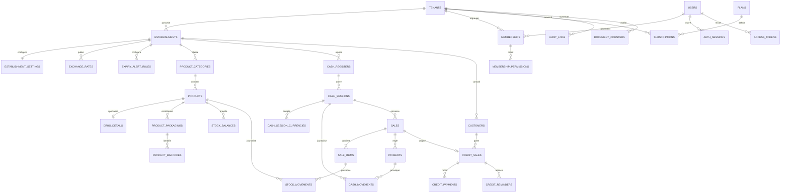

# KubaGest — MLD actuel

> **Mise à jour du 6 novembre 2026 :** la migration additive
> `1730400000000-target-v1-foundation` est désormais présente dans le code et
> enregistrée par TypeORM. Elle prépare le passage au MLD cible V1.1, mais son
> application sur PostgreSQL reste à confirmer. Le présent document continue
> donc de distinguer le schéma historique observé des structures cibles non
> encore certifiées en production.

## 1. Objet, sources et niveau de preuve

Ce document décrit le modèle observable dans le dépôt au 6 novembre 2026. Il est fondé sur les entités TypeORM de `backend/src`, les migrations enregistrées dans `backend/src/database/typeorm.config.ts` et les services qui les utilisent.

Il ne constitue pas une attestation du schéma réellement déployé. Aucune connexion à PostgreSQL ni lecture de `information_schema` n'a été effectuée. Une table indiquée « migrée » signifie seulement qu'une migration versionnée et enregistrée la crée. En mode `sqljs`, TypeORM utilise `synchronize: true` et peut donc produire un schéma légèrement différent des migrations PostgreSQL.

Conventions : `PK` = clé primaire, `FK` = clé étrangère, `UQ` = contrainte/index unique, `IDX` = index. Sauf indication contraire, les identifiants sont des `uuid` générés, les montants des `numeric(20,6)`, et les dates techniques des `timestamptz`.

## 2. Vue d'ensemble

Le modèle compte 32 entités. Il est multi-tenant par répétition de `tenant_id` dans les tables métier. Les tables rattachées à un point de vente répètent également `establishment_id`. Plusieurs migrations utilisent des FK composites afin d'empêcher les références entre tenants.

Le diagramme représente les relations logiques et les FK identifiées. Certaines colonnes d'acteur (`cashier_id`, `created_by`, etc.) ne disposent pas toutes d'une FK physique dans les migrations actuelles.

## 3. Socle, identité et abonnement

### `tenants`

- **Rôle :** commerce abonné, racine d'isolation.
- **Colonnes :** `id uuid` (PK), `name varchar(150)`, `status varchar(20)` (`trial|active|suspended|closed`), `currency varchar(3)` (`USD|CDF`), `address varchar(255)?`, `created_at`, `updated_at`.
- **Contraintes :** contrôles de statut et devise. L'ancien champ `plan` est retiré par migration.
- **Relations :** parent des établissements, memberships, abonnements et données métier.
- **Module :** `TenantsModule`.

### `establishments`

- **Rôle :** point de vente du tenant.
- **Colonnes :** `id`, `tenant_id`, `name varchar(150)`, `activity_type varchar(20)`, `timezone varchar(60)`, `address text?`, `is_active boolean`, timestamps.
- **Clés/contraintes :** PK `id`; FK `tenant_id -> tenants.id`; UQ `(tenant_id)` limite actuellement un tenant à un établissement; clé candidate `(tenant_id,id)`; activité limitée à `boutique|alimentation|pharmacie`; IDX `tenant_id`.
- **Module :** `TenantsModule`.

### `users`

- **Rôle :** identité globale d'authentification.
- **Colonnes :** `id`, `email varchar(255)`, `first_name varchar(80)?`, `last_name varchar(80)?`, `password_hash varchar(255)`, `phone varchar(30)?`, `avatar_key text?`, `is_active boolean`, `password_changed_at timestamptz?`, `is_platform_admin boolean`, timestamps.
- **Contraintes :** email unique et index unique sur `lower(email)` dans la migration de socle. Les noms restent nullable dans la migration de profil.
- **Module :** `UsersModule` / `AuthModule`.

### `memberships`

- **Rôle :** appartenance d'un utilisateur à un tenant et rôle métier.
- **Colonnes :** `id`, `tenant_id`, `user_id`, `role varchar(20)`, `is_active`, timestamps.
- **Clés/contraintes :** FK vers `tenants` et `users`; UQ `(tenant_id,user_id)` et `(tenant_id,id)`; rôle `owner|cashier|stock_manager`; IDX `user_id`.
- **Module :** `UsersModule`.

### `membership_permissions`

- **Rôle :** dérogations de permission par membership.
- **Colonnes :** `id`, `tenant_id`, `membership_id`, `permission_code varchar(80)`, `allowed boolean`, `granted_by uuid?`, `reason text?`, timestamps.
- **Clés/contraintes :** FK composite `(tenant_id,membership_id) -> memberships`; UQ `(tenant_id,membership_id,permission_code)`; IDX tenant/membership. `granted_by` n'est pas confirmé comme FK physique.
- **Module :** `UsersModule`.

### `plans` et `subscriptions`

- **`plans` :** référentiel commercial : `id`, `code varchar(40)` UQ, `name varchar(100)`, `monthly_price numeric(20,6) >= 0`, `currency`, `max_employees integer? >= 0`, `is_active`, timestamps.
- **`subscriptions` :** périodes contractuelles : `id`, `tenant_id`, `plan_id`, `status`, `starts_at`, `ends_at?`, `agreed_price?`, `currency`, `employee_limit?`, timestamps. FK vers tenant et plan, IDX tenant, contrôles de dates/montants, exclusion GiST des périodes qui se chevauchent.
- **Module :** `TenantsModule`.

### `auth_sessions` et `access_tokens`

- **`auth_sessions` :** `id`, `user_id`, `refresh_token_hash text` UQ, `client_type`, `expires_at`, `last_seen_at?`, `revoked_at?`, `replaced_by_id?`, `created_at`. FK utilisateur et auto-FK de rotation; index utilisateur/expiration.
- **`access_tokens` :** `id`, `user_id`, `tenant_id?`, `purpose`, `token_hash text` UQ, `expires_at`, `consumed_at?`, `created_by?`, `created_at`. FK utilisateur/tenant/créateur selon migration; index utilisateur/expiration.
- **Module :** `AuthModule`.

## 4. Paramétrage et catalogue

### Tables de paramétrage

| Table | Colonnes principales | Contraintes et relations | Module |
|---|---|---|---|
| `establishment_settings` | `id`, `tenant_id`, `establishment_id`, `max_discount_percent numeric(5,2)`, `payment_tolerance numeric(20,6)`, `expiry_boundary varchar(20)`, timestamps | UQ établissement; FK composite établissement; remise 0..100, tolérance >= 0, frontière `start_of_day|end_of_day` | Tenants |
| `expiry_alert_rules` | `id`, tenant, établissement, `days_before integer`, `is_active`, timestamps | UQ `(tenant,establishment,days_before)`; FK établissement; jours >= 0 | Tenants |
| `exchange_rates` | `id`, tenant, établissement, `cdf_per_usd numeric(20,10)`, `effective_at`, `created_by?`, `created_at` | UQ `(tenant,establishment,effective_at)`; FK établissement; taux > 0 | Tenants |

### Catalogue

| Table | Rôle et colonnes | Clés, contraintes et index | Module |
|---|---|---|---|
| `product_categories` | Catégorie locale : `id`, tenant, établissement, `name`, `is_active`, timestamps | FK établissement; UQ de `lower(name)` par établissement; clé candidate de portée | Catalog |
| `products` | Article local : `id`, tenant, établissement, `category_id?`, `sku`, `name`, `base_unit`, `reorder_level bigint`, `tracking_mode`, `allocation_policy`, `tax_rate numeric(7,4)`, `is_active`, timestamps | UQ `(tenant,sku)` et `(tenant,establishment,id)`; FK catégorie; contrôles quantité/taxe et listes de suivi/allocation; index tenant et catégorie | Catalog |
| `drug_details` | Extension médicament : `id`, tenant, établissement, `product_id`, `active_ingredient`, `strength`, `dosage_form`, `prescription_required?`, timestamps | UQ produit; FK composite produit | Catalog |
| `product_packagings` | Conditionnement/prix : `id`, tenant, établissement, `product_id`, `label`, `factor_to_base bigint`, `sale_price`, `is_base`, `is_active`, timestamps | UQ label par produit; clé candidate produit/id; index unique partiel d'un conditionnement de base; facteur > 0 et base = facteur 1; FK produit | Catalog |
| `product_barcodes` | Code scanner : `id`, tenant, établissement, `product_id`, `packaging_id`, `code`, `created_at` | UQ `(tenant,code)`; FK composite vers conditionnement et produit; index produit | Catalog |

Le catalogue actuel appartient à un établissement. Il ne sépare pas encore l'identité physique partagée du produit, son référencement local et ses prix.

## 5. Ventes, caisse et stock actuels

### `document_counters`

- **Rôle :** numérotation transactionnelle.
- **Colonnes :** `id`, `tenant_id`, `document_kind varchar(30)`, `period varchar(10)`, `last_value bigint`, `updated_at`.
- **Contraintes :** UQ `(tenant_id,document_kind,period)`, compteur >= 0. Aucune FK tenant explicite n'est visible dans la migration de création.
- **Module propriétaire :** service partagé `documents`, utilisé notamment par ventes/crédits.

### Caisse

| Table | Colonnes | Contraintes/relations | Module |
|---|---|---|---|
| `cash_registers` | `id`, tenant, établissement, `name`, `is_active`, timestamps | FK établissement; UQ portée; nom unique insensible à la casse dans la migration | Cash |
| `cash_sessions` | `id`, tenant, établissement, `register_id`, `cashier_id`, `status`, `opened_by`, `opened_at`, `closed_by?`, `closed_at?`, `closing_reason?`, timestamps | FK caisse; statut ouvert/fermé; fermeture >= ouverture; index uniques partiels : une session ouverte par caisse et par caissier | Cash |
| `cash_session_currencies` | `id`, tenant, établissement, `session_id`, `currency`, `opening_amount`, `expected_at_close?`, `counted_at_close?`, `difference_at_close?`, timestamps | FK session; UQ session/devise; devise USD/CDF; ouverture >= 0 | Cash |
| `cash_movements` | `id`, tenant, établissement, `session_id`, `currency`, `amount_delta`, `kind`, `payment_id?`, `credit_payment_id?`, `actor_id?`, `occurred_at`, `created_at` | FK session; montant non nul; exactement une des deux origines. Les FK vers paiement/crédit ne sont pas ajoutées dans cette migration | Cash |

### Ventes

| Table | Colonnes | Contraintes/relations | Module |
|---|---|---|---|
| `sales` | `id`, tenant, établissement, `number`, `cashier_id`, `session_id?`, `status`, `reference_currency`, `channel`, `subtotal`, `discount_total`, `tax_total`, `total`, `rounding_adjustment`, `posted_at`, timestamps | UQ numéro/tenant et clé candidate; FK établissement/session; statuts et canaux fermés; identité arithmétique du total; IDX date | Sales |
| `sale_items` | `id`, tenant, établissement, `sale_id`, `line_number`, `product_id`, `packaging_id`, snapshots SKU/nom/conditionnement/facteur, quantités, prix/remise/taxe/net, `created_at` | FK vente, produit, conditionnement; UQ ligne; quantités/facteur > 0; montants >= 0 | Sales |
| `payments` | `id`, tenant, établissement, `sale_id`, `session_id?`, `direction`, `purpose`, `method`, `currency`, `amount`, `received_by?`, `occurred_at`, `created_at` | FK vente; listes fermées; montant > 0; IDX vente. La migration ne crée pas de FK session | Sales |

### Stock simplifié

| Table | Colonnes | Contraintes/relations | Module |
|---|---|---|---|
| `stock_balances` | `id`, tenant, établissement, `product_id`, `bucket`, `quantity_base bigint`, timestamps | UQ produit/compartiment; FK produit; compartiment `available|quarantine`; quantité >= 0 | Stock |
| `stock_movements` | `id`, tenant, établissement, `product_id`, `bucket`, `quantity_delta bigint`, `kind`, `sale_item_id?`, `reference?`, `actor_id?`, `occurred_at`, `created_at` | FK produit et ligne de vente; quantité non nulle; type `entry|sale|adjustment`; index produit et vente | Stock |

Le stock actuel est agrégé par produit et compartiment : aucun entrepôt, lot, réception, fournisseur, transfert, inventaire formalisé ou valorisation CUMP n'est présent. Le coût de vente n'est pas conservé sur les lignes.

## 6. Crédit client présent dans le code

| Table | Rôle et colonnes | Contraintes/relations | Module |
|---|---|---|---|
| `customers` | Client : `id`, tenant, établissement, `name`, `phone?`, `credit_limit`, `is_active`, `note?`, timestamps | FK établissement; téléphone unique non nul par établissement; limite >= 0 | Credits |
| `credit_sales` | Dette : `id`, tenant, établissement, `customer_id`, `sale_id?`, `number`, `total`, `paid_total`, `due_date?`, `status`, `note?`, `created_by?`, timestamps | FK client et vente; numéro unique tenant; une dette par vente; contrôles montants/statut | Credits |
| `credit_payments` | Règlement : `id`, tenant, établissement, `credit_id`, `amount`, `method`, `paid_at`, `created_by?`, `created_at` | FK crédit; montant > 0; méthode `cash|mobile` | Credits |
| `credit_reminders` | Relance : `id`, tenant, établissement, `credit_id`, `channel`, `status`, `recipient?`, `message`, `sent_at`, `created_at` | FK crédit; canal SMS; statut `sent|failed` | Credits |

Ce sous-modèle existe actuellement, mais contredit la décision cible V1 « pas de vente à crédit dans le parcours commercial V1 ». Il doit être isolé/reporté plutôt que supprimé sans analyse de données.

## 7. Audit

### `audit_logs`

- **Rôle :** journal fonctionnel transversal.
- **Colonnes :** `id`, `tenant_id?`, `establishment_id?`, `actor_user_id?`, `actor_membership_id?`, `action varchar(100)`, `entity_type varchar(60)`, `entity_id varchar(64)?`, `reason text?`, `old_values jsonb?`, `new_values jsonb?`, `request_id uuid?`, `occurred_at`, `created_at` selon l'entité actuelle.
- **Contraintes/index :** FK tenant et références d'acteur renforcées dans la migration de socle; index tenant, tenant/date et entité. La nature descriptive de `entity_type/entity_id` ne permet pas de FK polymorphe.
- **Module :** `AuditModule`.

## 8. Écarts entre entités et migrations à surveiller

1. Les migrations PostgreSQL sont la source de déploiement, tandis que SQL.js utilise la synchronisation des entités. Les deux chemins doivent être comparés sur une base jetable.
2. Plusieurs identifiants d'acteur ou d'origine sont typés `uuid` sans FK physique confirmée (`document_counters.tenant_id`, certaines colonnes de caisse/paiement).
3. `cash_registers.name` est unique sur `lower(name)` dans la migration, mais l'entité exprime une unicité simple : risque de divergence en synchronisation.
4. Les trois colonnes de clôture de caisse sont nullable physiquement; leur obligation à la fermeture dépend du service, sans trigger inter-table identifié.
5. `audit_logs.entity_id` est `varchar(64)` et non `uuid`, ce qui est volontairement descriptif mais limite l'intégrité référentielle.
6. La présence réelle des migrations dans chaque environnement PostgreSQL, leur ordre d'application et l'état des contraintes doivent être confirmés via `typeorm migration:show` et une introspection autorisée.
